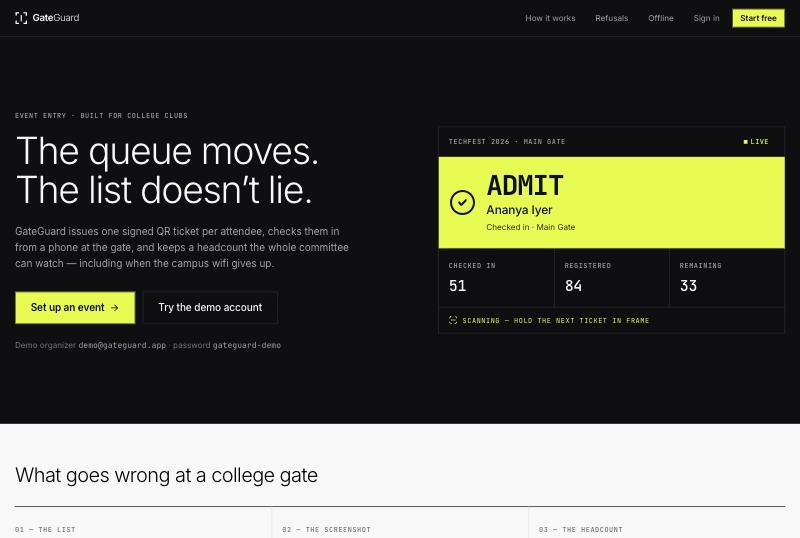
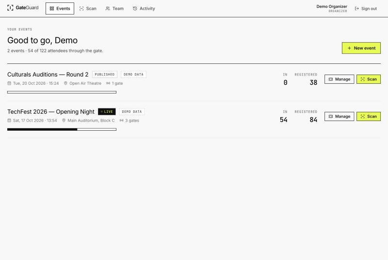
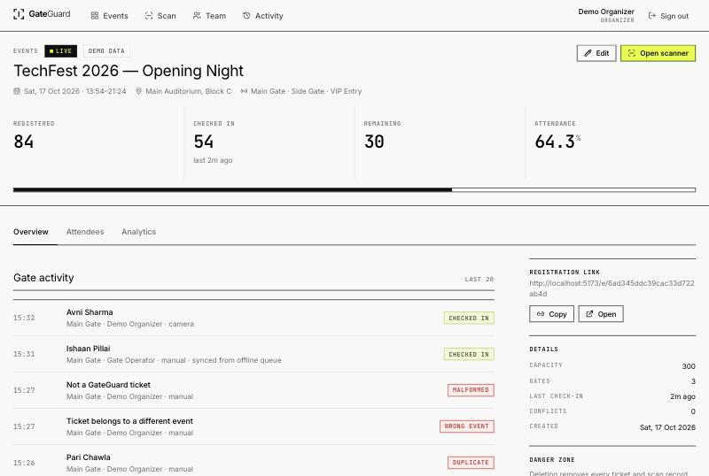
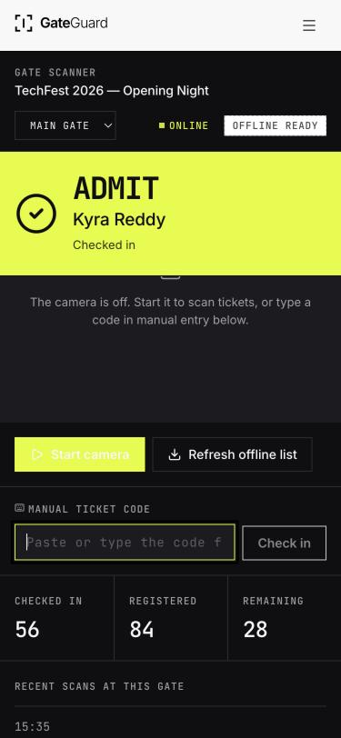
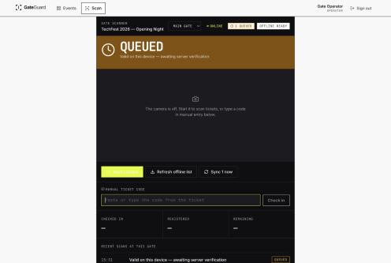
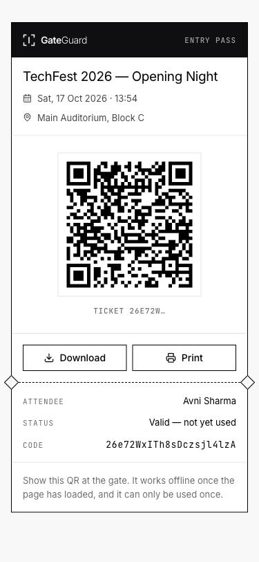

<div align="center">

# GateGuard

**QR ticketing, gate scanning and live attendance for college events.**

One signed QR ticket per attendee · a phone scanner that works at the gate ·
a headcount the whole committee can trust · an offline queue that is honest
about what it does and does not know.

**[Live demo](https://gateguard-omega.vercel.app)** ·
[API health](https://gateguard-omega.vercel.app/api/health)

[Quick start](#quick-start) · [Architecture](#architecture) ·
[Offline behaviour](#offline-operation-and-its-limits) · [API](docs/API.md) ·
[Security](#security)

</div>



---

## What it is

GateGuard is a small, complete event-entry system for a college club: create an
event, register attendees (or let them register themselves), issue a unique
signed QR ticket to each one, and check them in at the door from any phone.

## The problem it solves

At a college gate three things go wrong, every time:

1. **The list.** A printed sheet and three volunteers reading names. The queue
   stalls on every spelling.
2. **The screenshot.** One pass gets photographed and forwarded to six friends.
   Paper cannot tell you a ticket already walked in.
3. **The headcount.** Someone asks how many are inside, and the honest answer
   is a guess.

GateGuard replaces all three with a ticket the server signed, a scan the server
resolves, and a count the server owns.

## Features

**Mandatory capabilities**

- **A unique QR per attendee.** Each ticket code is 16 bytes from a CSPRNG
  (22 url-safe characters), never a sequential id. The QR payload is
  `GG1:<eventId>:<code>:<HMAC-SHA256 signature>` and contains no name, email or
  phone, so a photographed pass leaks nothing about its holder.
- **A working camera scanner.** ZXing-based, rear camera by default, with
  explicit permission / no-camera / camera-busy states, a start-stop control, a
  manual code field, and a debounce so one ticket held in frame fires exactly
  one request.
- **A live headcount.** Registered, checked in, remaining and attendance
  percentage, read from the database and refreshed by polling (paused when the
  tab is hidden). A scan response carries fresh counts, so the operator's own
  numbers move instantly.
- **Refusals with reasons.** Eight distinct outcomes, each with its own word,
  icon and explanation — colour is never the only signal.

| Outcome | What the operator sees | Why |
| --- | --- | --- |
| `checked_in` | **Admit** | Signature valid, ticket unused, right event |
| `duplicate` | **Already in** | Plus when and at which gate it was first used |
| `conflict` | **Conflict** | An offline scan synced for a ticket another gate already used |
| `invalid_signature` | **Forged** | Decodes fine, but GateGuard never signed it |
| `wrong_event` | **Wrong event** | A real ticket, for a different event |
| `unknown` | **Unknown** | No such ticket in this event |
| `cancelled` | **Cancelled** | The organizer revoked it |
| `malformed` | **Not a ticket** | Not a GateGuard QR at all |
| `re_entered` | **Back in** | Left earlier and the organizer allows re-entry |
| `checked_out` | **Exit** | Scanned leaving; occupancy drops by one |
| `invalid_exit` | **Not inside** | Exit scanned for someone never admitted, or already out |
| `expired` | **Expired** | A rotating code older than its 30-second window |
| `replayed` | **Code used** | That exact rotating code has already been redeemed |
| `face_review` | **Check face** | Event has face check on — the photo is shown and the ticket is held, not consumed |
| `face_rejected` | **Not them** | The operator said the face did not match; the ticket stays valid |

**Face check at the gate**

Optional per event. Attendees may add a photo when they register — explicit
consent, a plain `<input capture>` so the platform owns the camera, downscaled
to a 320px JPEG in the browser. When an event has face check on, scanning a
ticket **does not admit anyone**: the server returns the registration photo and
holds the ticket, the operator compares it with the person in front of them,
and taps *Match — admit* or *Not them*. Only a confirmed match runs the atomic
claim, so a refused face never consumes the ticket and the attendee can be
sorted out at the desk. Both the review and the verdict land in the scan log.

This is **photo verification reviewed by the operator, not face recognition**.
No biometric template is computed, stored or matched — see
[Why not face recognition](#why-not-face-recognition). Photos are stored on the
ticket with `select: false`, so they are never returned by the attendee list,
search or CSV export; only the scan that needs the comparison asks for one.
Tickets with no photo are admitted as normal.

**Rotating codes**

The pass shows a code that changes every 30 seconds (`GG2:<eventId>:<code>:<step>:<sig>`,
signed per time step with the same `TICKET_SECRET`). The gate accepts the
current step and one either side, so a phone 30 seconds out of sync still
works. Each code is **single use**: the ticket records the highest step it has
redeemed, enforced inside the same conditional update that already makes
check-in concurrency-safe, so a replay costs no extra query.

A forwarded screenshot is dead within a minute. **This does not stop someone
sharing their live screen** — only the person at the gate can judge that, which
is what the photo check is for.

The static `GG1:` code still works and is what download, print and the offline
queue use: a rotating code saved to a file would be dead before anyone scanned
it. Queued offline scans are exempt from replay protection, since their codes
are minutes old by the time they sync and `scanId` already dedupes them.

Two consequences worth knowing: scanning the same person in and out inside one
30-second window needs a fresh code (or the manual code field, which carries no
step), and the pass stops issuing codes while you are recorded inside, handing
one back only if the event allows re-entry.

**Entry, exit and recorded occupancy**

The scanner has an explicit Entry/Exit switch — the whole screen changes
colour in exit mode, because scanning the wrong way corrupts the number. A
ticket moves `issued → inside → outside`, each transition a conditional update
on the state itself, so concurrent gates cannot both admit or both release the
same person. Re-entry is an event setting: off means leaving is final; on means
the ticket may come back and the outcome reads **Back in**, without counting
the attendee twice.

Occupancy is the count of tickets currently `inside`, shown against a safe
occupancy limit (falling back to ticket capacity) with amber and red bands.

It is labelled **recorded occupancy**, never "people inside", and the UI says
so: a figure is only as good as exit discipline, and a gate that admits without
scanning exits drifts high. The stats carry an `exitsRecorded` flag so the
interface can tell you when nobody has scanned an exit yet and the number is
really just "admitted so far".

**Also built**

Organizer dashboard with per-event live stats · event create/edit with
server-side validation · attendee list with search, status filter, reissue and
cancel · bulk import · public registration page with capacity enforcement ·
attendee ticket page with QR download and print · gate operator accounts scoped
to specific events · analytics (arrivals over time, throughput per gate, scan
outcomes) · CSV export of attendees and scans · audit trail · installable PWA ·
offline scan queue with reconciliation.

## Screenshots

| Organizer dashboard | Event detail and gate activity |
| --- | --- |
|  |  |

| Gate scanner — admitted | Gate scanner — queued offline | Attendee pass |
| --- | --- | --- |
|  |  |  |

## Tech stack

| Layer | Choice | Why |
| --- | --- | --- |
| Frontend | React 19, Vite 7, TypeScript | Fast builds, typed API surface |
| Routing / data | React Router 7, TanStack Query | Polling, cache invalidation, retry control |
| Forms | React Hook Form + Zod | Same schema shape as the server's validation |
| QR | `qrcode.react` (generate), `@zxing/browser` (decode) | Maintained, no native deps |
| Offline | `vite-plugin-pwa` (Workbox), `idb` | App-shell cache + IndexedDB queue |
| Styling | Hand-written CSS with design tokens | The design is hairline-rule driven; utilities would fight it |
| Backend | Node 20+, Express 4, Mongoose 8 | Small, boring, well understood |
| Validation | Zod | Every request body parsed before a handler sees it |
| Auth | JWT in an `httpOnly` cookie, bcrypt | Same-origin in production, so no token in JS |
| Tests | Vitest, Supertest, Testing Library, `mongodb-memory-server` | 54 tests, no external services needed |

## Architecture

```
┌──────────────────────── browser ─────────────────────────┐
│  React SPA (Vite)                                        │
│    ├── organizer views ── TanStack Query ──┐             │
│    ├── gate scanner ── ZXing ── useGate ───┤             │
│    └── service worker (app shell) │        │             │
│         IndexedDB: queue · manifest · admitted           │
└───────────────────────────────────┼────────┼─────────────┘
                                    │ /api (same origin)
┌───────────────────────────────────▼────────▼─────────────┐
│  Express                                                 │
│    routes ─ middleware (auth · validate · rate limit)    │
│      └── services: checkin (atomic) · stats              │
│            └── lib/tickets: HMAC sign + parse            │
│                  └── Mongoose models                     │
└───────────────────────────────────┬──────────────────────┘
                                    │
                            ┌───────▼────────┐
                            │  MongoDB       │
                            │  users events  │
                            │  tickets scans │
                            │  auditlogs     │
                            └────────────────┘
```

Frontend and API share one origin in production, so the session cookie is
`sameSite=lax` and no CORS exception is needed. In development Vite proxies
`/api` to `localhost:4000`, which reproduces that exactly.

### Data flow of one scan

1. The camera decodes `GG1:<eventId>:<code>:<sig>`.
2. `POST /api/events/:id/checkin` with a client-generated `scanId`.
3. The server checks the HMAC before touching the database, so a forged QR
   never becomes a lookup.
4. Check-in is a single conditional update:

   ```js
   Ticket.findOneAndUpdate(
     { _id, status: 'valid', checkedInAt: null },   // the condition IS the lock
     { $set: { checkedInAt, checkedInBy, checkedInGate, checkInScanId } },
     { new: true }
   )
   ```

   Only the request that flips `checkedInAt` from `null` wins. Two operators
   scanning the same ticket at the same instant cannot both succeed — the
   loser's response says *already checked in*, with the time and gate.
5. The scan is appended to `scanlogs` with its `scanId`, which carries a unique
   index. A retried request replays the stored outcome instead of double
   counting.
6. The response carries both the result and fresh stats.

### Why polling, not WebSockets

The backend runs as a stateless function behind a load balancer. An in-process
event emitter would only notify listeners that happen to share an instance with
the writer, so SSE or WebSockets here would be *less* correct, not more. The
scanner updates its own counts from each scan response, and other viewers poll
every 8 seconds and pause when the tab is hidden. That is accurate, cheap, and
survives a cold start.

## Quick start

Requires Node 20+ and a MongoDB you can reach (local `mongod` or an Atlas URI).

```bash
git clone https://github.com/Sree24-ui/gateguard-event-entry.git
cd gateguard-event-entry
npm install
cp .env.example .env     # then edit, see below
npm run seed             # optional: demo organizer, operator and two events
npm run dev              # API on :4000, app on http://localhost:5173
```

Open http://localhost:5173 and sign in with the seeded accounts:

| Role | Email | Password |
| --- | --- | --- |
| Organizer | `demo@gateguard.app` | `gateguard-demo` |
| Gate operator | `gate@gateguard.app` | `gateguard-demo` |

Everything the seed creates is flagged `isDemo` and labelled **DEMO DATA** in
the interface.

### Environment configuration

Copy `.env.example` to `.env`. Never commit `.env`.

| Variable | Required | Purpose |
| --- | --- | --- |
| `MONGODB_URI` | yes | Connection string |
| `JWT_SECRET` | yes | Signs session cookies. `openssl rand -base64 48` |
| `TICKET_SECRET` | yes | Signs QR payloads. **Rotating it invalidates every QR already issued.** |
| `SESSION_DAYS` | no | Session lifetime, default 7 |
| `PORT` | no | Local API port, default 4000 |
| `CORS_ORIGINS` | no | Extra browser origins. Empty for the same-origin deployment |
| `DEMO_PASSWORD` | no | Password the seed script uses |

### Database setup

No migrations to run. Mongoose creates the collections and builds the indexes
on first connect:

| Collection | Indexes |
| --- | --- |
| `users` | `email` unique, `role`, `organizer` |
| `events` | `organizer`, `status`, `{ organizer, startsAt }` |
| `tickets` | `code` unique, `{ event, attendee.email }` unique, `{ event, checkedInAt }`, `{ event, createdAt }` |
| `scanlogs` | `scanId` unique, `event`, `outcome`, `{ event, createdAt }` |
| `auditlogs` | `action`, `event`, `createdAt` |

The `{ event, attendee.email }` unique index is what prevents double
registration; the `scanId` unique index is what makes check-in idempotent.

With MongoDB Atlas: create a free M0 cluster, add a database user, allow
network access, and paste the connection string into `MONGODB_URI`.

### Commands

| Command | What it does |
| --- | --- |
| `npm run dev` | API and web dev server together |
| `npm run dev:api` / `npm run dev:web` | Either half on its own |
| `npm run build` | Production build of the frontend |
| `npm test` | Backend and frontend suites |
| `npm run test:server` / `npm run test:web` | Either suite |
| `npm run lint` | ESLint, zero warnings allowed |
| `npm run seed` | Demo data (`-- --reset` wipes it first) |
| `npm run backfill -w server` | One-time: gives pre-existing tickets a state. Idempotent |

## Testing

```bash
npm test
```

54 automated tests. The backend suite starts its own in-memory MongoDB, so no
services need to be running; set `MONGODB_TEST_URI` to reuse a local `mongod`
instead.

**Backend — 33 tests** (`server/test/`)

Ticket issuing and uniqueness · no PII in the QR payload · duplicate
registration refused · capacity enforced server-side · public ticket lookup
exposes only the pass · reissue invalidates the old QR · signature accepted,
tampered signature and tampered event id refused · bare code accepted as manual
entry · valid check-in moves the headcount · duplicate refused with first-use
time and gate · forged, malformed and unknown codes refused · wrong-event
refused · cancelled refused · manual fallback · **six concurrent scans of one
ticket produce exactly one check-in** · retried `scanId` replays its outcome ·
draft events refuse check-ins · offline queue syncs once and is idempotent on
replay · conflicting offline scan flagged · offline manifest carries no
attendee data · 16 protected routes reject anonymous callers · cross-organizer
access refused · operator scope enforced on 6 operations · role cannot be
escalated at signup · sign-out clears the session · tampered token rejected ·
field-level validation on events, attendees and scans · regex input is not
treated as a search operator · no stack traces in responses.

**Frontend — 21 tests** (`web/src/test/`)

Payload parsing accepts what the server produced and rejects seven malformed
shapes · the client hash matches the server's `offlineHash` byte for byte ·
offline verdicts for admit / unknown / wrong event / already-admitted-here /
already-checked-in / no-manifest · scan ids do not collide · admit updates
stats · a 409 refusal is rendered from its body rather than as a generic error
· the same code in frame fires one request, a typed code always fires · an
unreachable server queues instead of refusing · a 502 queues · a 403 still
refuses · a network failure falls back to the queue.

**Verified by hand in a browser** (dev server, Chromium, desktop 1280×860 and
mobile 375×812): the full organizer flow, the public registration flow through
to a rendered QR, manual check-in, duplicate / wrong-event / not-a-ticket
refusals, the exact QR payload string round-tripping through check-in, caching
the offline manifest, queueing a scan with the API stopped, automatic sync when
the API returned, role-restricted navigation for an operator, and both viewport
sizes.

**Not covered by automated tests**

- Optical decoding through a physical camera. The decode path is a
  `@zxing/browser` callback; everything downstream of it is tested with
  fixtures, and manual entry exercises the same `submit()` path. Scanning a
  printed ticket with a real phone camera remains an outstanding manual check.
- Rate limiting is configured but skipped under `NODE_ENV=test` (hundreds of
  requests run through one process). Verify it by hand against a running
  server.
- No end-to-end browser suite (Playwright) is included; the flows above were
  driven manually instead.
- **One transient miss observed.** On the very first interaction after a brand
  new deployment — while the service worker was installing and precaching — a
  manual check-in reached the server and was recorded, but the verdict band did
  not render. It did not recur on any subsequent scan, on a fresh page load, or
  after a reload, so it is tied to the one-off service-worker install rather
  than to the scan path. It degrades safely: the scan is in the database with
  its `scanId`, and rescanning the ticket returns *Already in* with the gate and
  time rather than silently admitting twice. Worth a proper repro before a
  large event; the practical workaround is to load the scanner once before
  doors open, which an operator does anyway to cache the offline list.

## Offline operation and its limits

This is the part most worth reading carefully, because it is where it would be
easy to lie.

**What the device caches.** Before doors open the operator taps *Prepare for
offline*. The device downloads a manifest for that event containing the first
16 hex characters of `SHA-256(code)` for every valid ticket, plus the hashes
already checked in as of that moment. It contains **no attendee data and never
the signing key** — the `TICKET_SECRET` exists only on the server.

**What the device can decide alone.** Whether a scanned string is structurally
a GateGuard ticket, whether it names this event, and whether its hash is in the
cached valid set. That is strictly weaker than the server's check (it cannot
verify the HMAC) but strong enough to refuse a forged or foreign QR instantly.

**What happens to an accepted offline scan.** It is written to IndexedDB with a
client-generated `scanId` and shown as **Queued — awaiting server
verification**, in amber, not green. It is never called a check-in. The queue
survives reloads and the app being closed.

**Reconciliation.** When the connection returns the queue is replayed through
`POST /checkin/batch`. Each scan is resolved by the same atomic update as an
online scan, so exactly one check-in survives per ticket no matter how many
gates queued it. The outcomes come back per scan, the operator's pinned verdict
updates from *Queued* to what the server actually decided, and anything refused
on sync is added to the scan history with its reason.

**The limitation we do not paper over.** Two gates that are offline *at the same
time* cannot know about each other. Both may provisionally admit the same
ticket, and both people will physically walk in. GateGuard cannot prevent that —
no system can without the gates communicating. What it does instead:

- labels those admissions as provisional while they are unverified;
- accepts exactly one of them as the official check-in on sync;
- records the loser as a `conflict`, increments `conflictCount` on the ticket,
  and surfaces it on the event's stats and in the scan log for the organizer;
- keeps the headcount equal to the number of *server-confirmed* check-ins.

If you need a hard guarantee against double entry, keep at least one gate
online. GateGuard tells you when it cannot give you that guarantee rather than
pretending it can.

**Service worker scope.** The app shell, fonts and icons are precached. API
responses are deliberately **not** cached: a cached authenticated response could
serve one operator's data to another, and a stale attendance count is worse
than an absent one.

## Why not face recognition

The judges asked for "face ID". We build the review step and deliberately stop
short of recognition, for three reasons:

1. **It would make a club hold biometric data.** A face embedding is sensitive
   personal data under India's DPDP Act 2023 and GDPR Article 9. A college
   society running one fest should not be the custodian of a biometric database
   of its attendees, and the consent, retention and breach obligations that
   come with it are not something a committee can meet.
2. **It would be less accurate than the operator.** On-device matching means
   shipping a multi-megabyte model into a PWA that has to work offline, then
   asking it to match faces at night, in a crowd, under coloured stage lighting.
   False rejections land on real students at the front of a queue. A human
   already standing there, holding a clear photo, is the better matcher.
3. **It does not change the threat model.** The attack is a shared screenshot of
   someone else's QR. Showing the operator who the ticket belongs to defeats
   that completely. Recognition adds cost and risk without closing a gap the
   review leaves open.

If recognition is genuinely required, the honest shape is: an explicit
biometric consent flow, embeddings computed and stored server-side with a
documented retention window, a match threshold tuned against a real sample, and
the operator review kept as the fallback for every non-match. That is a project
in itself, not a feature flag.

## Security

| Area | What is done |
| --- | --- |
| Ticket codes | 16 CSPRNG bytes, not enumerable, never sequential |
| QR payloads | HMAC-SHA256 signed; verified in constant time before any database lookup |
| Payload privacy | No name, email, phone or college id in the QR |
| Sessions | JWT in an `httpOnly`, `sameSite=lax` cookie, `secure` in production |
| Passwords | bcrypt, cost 12; never returned by any endpoint |
| Authorization | Every event route resolves ownership or operator assignment; 16 routes covered by anonymous-access tests |
| Privilege | Signup always yields an organizer scoped to its own events. Operator accounts can only be minted by an organizer |
| Input | Zod on every body; the frontend is never the only check |
| Injection | Search input is regex-escaped before it reaches Mongo |
| Rate limits | Auth 20 / 10 min, public registration 15 / 10 min, ticket lookup 120 / 10 min, scanning 240 / min. Disabled only by an explicit `RATE_LIMIT_DISABLED=1`, never by an environment name |
| Secrets | No environment is exempt from the required-vars check, and there are no fallback secret literals |
| Entry photos | Explicit consent, `select: false` on the field, never in lists, exports or the QR, deleted with the ticket |
| Scan timestamps | Clamped to the last 24 hours and not in the future, so a client cannot backdate or forward-date a check-in |
| CSP | Set on every response by the static host, with `frame-ancestors 'none'` and `object-src 'none'` |
| Headers | Helmet; `x-powered-by` disabled |
| CORS | Allowlist, empty by default because production is same-origin |
| Errors | One handler; no stack traces, driver errors or secrets in responses |
| Audit | Administrative actions recorded with actor, target and summary |
| Secrets | `.env` gitignored, `.env.example` holds placeholders only |

**Known limitations, stated plainly**

- A ticket's URL (`/t/<code>`) is a bearer capability: anyone with the link can
  see that pass. That is the same property the QR itself has, and the page
  exposes only what is printed on the ticket.
- Operator passwords are set by the organizer and there is no forced rotation
  or password-reset flow.
- There is no email delivery; ticket links are shared by the organizer.
- Sessions cannot be revoked server-side before the JWT expires.
- Offline double-entry across simultaneously disconnected gates is detected and
  reported, not prevented. See above.

## Deployment

Live at **https://gateguard-omega.vercel.app** (health:
[`/api/health`](https://gateguard-omega.vercel.app/api/health)).

The app deploys as a single origin: static frontend plus the Express app as a
serverless function under `/api`.

```jsonc
// vercel.json — build the SPA, send /api/* to the Express handler
{
  "buildCommand": "npm run build",
  "outputDirectory": "web/dist",
  // Vercel sets NODE_ENV=production for the build, which makes npm skip the
  // devDependencies the build itself needs.
  "installCommand": "npm install --include=dev",
  "rewrites": [
    { "source": "/api/(.*)", "destination": "/api" },
    { "source": "/((?!api/).*)", "destination": "/index.html" }
  ]
}
```

1. Create a MongoDB Atlas cluster and copy its connection string.
2. Set `MONGODB_URI`, `JWT_SECRET` and `TICKET_SECRET` as production
   environment variables on the host. Do not put them in any `VITE_*`
   variable — those are compiled into the public bundle.
3. Deploy. `api/index.js` reuses one Mongoose connection across warm
   invocations.
4. Check `/api/health`; it reports the database connection state.

Because frontend and API share an origin, no `CORS_ORIGINS` entry is needed and
the session cookie works with `sameSite=lax`.

## Project layout

```
gateguard/
├── api/index.js            serverless entrypoint → the same Express app
├── server/
│   ├── src/
│   │   ├── app.js          express wiring
│   │   ├── config/         environment
│   │   ├── db/             connection reuse
│   │   ├── lib/            tickets (HMAC), csv, audit, errors, rate limits
│   │   ├── middleware/     auth, validate, errors
│   │   ├── models/         User, Event, Ticket, ScanLog, AuditLog
│   │   ├── routes/         auth, events, tickets, checkin, public, operators, audit
│   │   ├── services/       checkin (atomic), stats
│   │   └── scripts/seed.js demo data
│   └── test/               33 tests
├── web/
│   ├── src/
│   │   ├── components/     layout, metrics, dialog, charts, QR, brand
│   │   ├── features/scanner/  camera, gate logic, scanner screen
│   │   ├── hooks/          auth, toast, connectivity
│   │   ├── lib/            api client, offline store, scan parsing, formatting
│   │   ├── pages/          landing, auth, dashboard, event, team, activity, public
│   │   ├── styles/         design tokens and component CSS
│   │   └── test/           21 tests
│   └── public/             manifest icons
└── docs/                   API reference, screenshots
```

## Design

The interface is deliberately not a generic dashboard. The direction came from
studying three real design systems and committing to one:

- **teenage engineering** (primary) — a near-white canvas, hairline rules that
  organise content into ruled bands instead of a grid of cards, 0px radius on
  every component, and no shadows or gradients at all. Elevation is a hard cut
  to a carbon band, nothing else.
- **TWOTWO** (borrowed, narrowly) — voltage lime `#e3fc03` as the single
  chromatic accent, used strictly as functional punctuation: the primary action
  and the ADMIT verdict, never decoration. It sits at 16.7:1 against carbon,
  which is exactly the property a gate in daylight needs.
- **Vercel** (borrowed, narrowly) — monospace 11px uppercase stamps for labels
  and metadata, and tabular numerals so live counters do not jitter as they
  tick.

Red is reserved for refusals and amber for *queued, unverified* — three
semantic colours, each with exactly one job, everything else monochrome. Every
state is carried by a word and an icon as well as its colour. Contrast was
checked numerically: body text 19.7:1, secondary 8.8:1, metadata 4.8:1, ADMIT
16.7:1, REFUSED 5.9:1, control borders 3.5:1.

## License

MIT — see [LICENSE](LICENSE).
